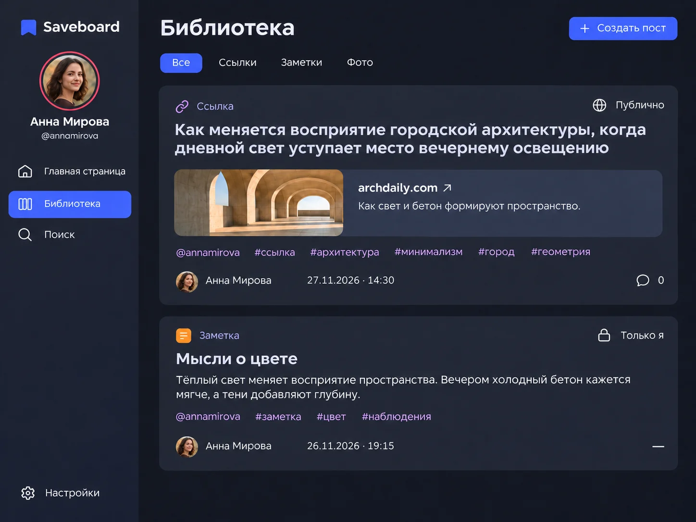

# Дизайн Saveboard

[Дизайн-лист с палитрой и 18 макетами](design-sheet.html) открывается локально в браузере. На GitHub изображения доступны в [каталоге экранов](screens). Для просмотра живых компонентов запустите `pnpm --dir frontend dev` из корня и откройте [UI-kit](http://127.0.0.1:5173/ui-kit).

## Как собрать новую страницу

1. Подключите `AppShell` и `PageHeading`. Оболочка получает текущего пользователя из сессии, рисует меню и переключается на раскрываемую навигацию при ширине до 680 px. Для гостевых форм используйте `Brand` и `FormCard`.
2. Берите поверхности, цвета текста, фокус, радиусы и интервалы из [tokens.css](../../frontend/src/styles/tokens.css). У карточки фон `--sb-surface`, внутренний отступ 20–32 px, вертикальный интервал 20 px. Основное действие и выбранный раздел выделяются кобальтом. Подпись и иконка дублируют значение цвета.
3. Собирайте формы из `FormField`, `Select`, `Button` и `FormMessage`. Для выбора тегов переиспользуйте `TagPicker`. Выбранные теги переносятся над отдельным полем ввода. Подсказки начинаются у его левого края, создание тега идёт после результатов. В поиске доступны только существующие теги.
4. Для постов используйте [Publication](../../frontend/src/features/library/publication.tsx). Сначала идут тип и видимость, затем заголовок с переносом, содержимое, теги и строка автора. Первые две метки вычисляются из username и типа. Они не расходуют лимит в 20 пользовательских тегов. Время отображается в часовом поясе читателя.
5. На узком экране проверьте длинный заголовок, 20 тегов, закрытое и раскрытое меню, фокус с клавиатуры и пустую выдачу. Для профиля карточка пользователя поднимается над статистикой и лентой.

[Состав UI-kit и примеры импорта](../../frontend/src/components/README.md) · [Типы публикаций](../../frontend/src/components/content/post-type-badge.tsx) · [Редактор](../../frontend/src/features/library/post-form.tsx)

## Карта экранов

| Маршрут | Назначение | Эталон |
| --- | --- | --- |
| `/` и `/feed` | Главная и личная библиотека | [Гость](screens/guest-home.webp) · [Библиотека](screens/library-navigation-desktop.webp) · [Телефон](screens/library-navigation-mobile.webp) · [Пустое состояние](screens/library-empty.webp) |
| `/search` | Текст, обязательные и исключённые теги, публичная или личная область | [Выдача](screens/search-results.webp) · [Состояния](screens/search-states.webp) |
| `/posts/$postId` | Полный пост, фото и сохранённые страницы | [Пост](screens/post-discussion.webp) · [Вложения](screens/attachment-views.webp) · [На телефоне](screens/mobile-search-post.webp) |
| `/posts/new` и `/posts/$postId/edit` | Создание и редактирование | [Тип](screens/post-type-picker-aligned.webp) · [Теги](screens/post-tag-suggestions-aligned.webp) · [Ссылка](screens/editor-link.webp) · [Фото](screens/editor-photos.webp) |
| `/profiles/$username` и `/settings` | Публичные посты автора и настройки своей учётной записи | [Профиль](screens/profile-stats-feed.webp) · [Настройки](screens/profile-settings.webp) |
| `/login` и `/register` | Формы доступа | [Вход](screens/sign-in-desktop.webp) · [Регистрация](screens/sign-up-desktop.webp) |
| `/notifications` | Список уведомлений и чтение выбранного сообщения | [Уведомления](screens/notifications-center.webp) |

[Скриншот реализации с длинным заголовком и 20 тегами](profile-check.webp) сделан в Chrome на тестовых данных.

## Данные и состояния

Публичный профиль показывает имя, username и число опубликованных публичных постов. Имя редактируется в настройках. Аватар строится из инициалов. Фото профиля, биография и обсуждения показаны на макетах для будущих этапов. Сейчас в правом нижнем углу поста и в статистике комментариев выводится прочерк. После подключения комментариев доступное обсуждение должно показывать иконку с реальным числом, включая ноль.

Библиотека показывает собственные публикации. Для будущих сохранённых чужих постов предусмотрено место в библиотеке. Дополнительный пункт избранного в меню не требуется.
